# Trade Approval — Application Architecture

**Current architecture version:** 3.3
**Last updated:** 2026-09-06
**Status:** Living source of truth

This document explains the major application components, their responsibilities, and how information moves from research to recommendations, approval, broker execution, reconciliation, and performance evaluation.

The Mermaid source in this file is authoritative. FigJam and other visual exports are derived views and may lag behind this document.

## Current architecture

Read the primary arrows from left to right. They represent the movement of time through one recommendation: discover an opportunity, ask the user to decide, validate and submit it, then monitor and measure what happened. Dotted arrows are supporting records, notifications, or feedback loops.

```mermaid
flowchart LR
    subgraph discover ["1. Discover and prepare"]
        sources[/"Market data, filings, news and events"/]
        normalize["Normalize and cache data"]
        scan["Scan eligible symbols"]
        risk["Calculate risk and position size"]
        rules["Apply portfolio rules"]
        recommend["Create exact buy recommendation"]
        queue["Build market-driven recommendation set"]

        sources ==> normalize
        normalize ==> scan
        scan ==> recommend
        risk --> recommend
        rules --> recommend
        recommend ==> queue
    end

    subgraph review ["2. Present and decide"]
        api["Secure application API"]
        mobile["Mobile recommendation card"]
        buyDecision{"Approve the buy?"}
        rejected["Record denied or expired proposal"]

        api ==> mobile
        mobile ==> buyDecision
        buyDecision -->|"No"| rejected
    end

    subgraph execute ["3. Validate and execute"]
        validate{"Safety checks pass?"}
        blocked["Return the exact blocked reason"]
        submit["Submit buy and protective stop"]
        broker["IBKR Paper or Live"]

        validate -->|"No"| blocked
        validate ==>|"Yes"| submit
        submit ==> broker
    end

    subgraph manage ["4. Monitor and learn"]
        reconcile["Reconcile orders, fills and positions"]
        monitor["Monitor the open position"]
        positionEvent{"Position event"}
        stopped["Protective stop closes position"]
        sellReview["Create sell approval request"]
        sellDecision{"Approve the sale?"}
        sellOrder["Submit approved sale"]
        closed["Record closed trade"]
        ledger[("Durable trading ledger")]
        activity["Activity and positions"]
        performance["Performance evaluation"]
        notifications["Notifications"]

        reconcile ==> monitor
        monitor ==> positionEvent
        positionEvent -->|"Protective stop"| stopped
        stopped ==> closed
        positionEvent -->|"Target or thesis change"| sellReview
        sellReview ==> sellDecision
        sellDecision -->|"Yes"| sellOrder
        sellDecision -.->|"No"| monitor
        closed ==> ledger
        ledger --> activity
        ledger --> performance
        ledger -.-> notifications
    end

    queue ==> api
    buyDecision ==>|"Yes"| validate
    rejected -.-> ledger
    blocked -.-> mobile
    blocked -.-> ledger
    broker ==> reconcile
    sellOrder -.-> broker
    buyDecision -.-> ledger
    validate -.-> ledger
    submit -.-> ledger
    reconcile -.-> ledger
    activity -.-> mobile
    notifications -.-> mobile
    performance -.->|"Validated feedback"| recommend

    style discover fill:#E8F1FF,stroke:#82AFFF
    style review fill:#E7F8F0,stroke:#6EC6A0
    style execute fill:#FFEDE5,stroke:#F59E72
    style manage fill:#F1ECFF,stroke:#A78BFA
    style buyDecision fill:#FFF5D9,stroke:#E9B949
    style validate fill:#FFE8E8,stroke:#E88A8A
    style positionEvent fill:#FFF5D9,stroke:#E9B949
    style sellDecision fill:#FFF5D9,stroke:#E9B949
    style ledger fill:#F4F5F7,stroke:#AAB2BD
```



## Component status

| Component | Responsibility | Status | Next milestone |
|---|---|---|---|
| Mobile app | Review recommendations and approve or deny decisions | Prototype | Add Activity and Positions |
| Secure application API | Coordinate the mobile client and local services | Prototype | Durable state and clearer service health |
| IBKR adapter | Quotes, account data, validation, and paper orders | Prototype | Reconciliation and recovery |
| Market scanner | Identify candidates that pass deterministic rules | Prototype | Being developed with recommendation work |
| Market and research layer | Normalize market, filing, news, and event data | Partial | Select licensed providers and cache model |
| Recommendation engine | Produce all currently qualified, ranked proposed trades with rationale | Prototype | Add intraday inputs and portfolio eligibility |
| Risk and position sizing | Calculate quantity, loss, concentration, and limits | Partial | Complete trade- and portfolio-risk inputs |
| Safety validation | Recheck price, account, approval, limits, and What-If | Prototype | Preserve exact validation results |
| Order service | Submit approved buys, protective stops, and separately approved ordinary sales | Prototype | Confirm durable broker identifiers |
| Broker reconciliation | Match app state to IBKR orders, fills, and positions | Next | Build first |
| Durable trading ledger | Persist proposals, decisions, submission attempts, broker orders, events, fills, and errors | Partial | SQLite schema and idempotency core implemented; connect service routes next |
| Activity and Positions | Show pending, filled, protected, and closed trades | Next | Build after ledger schema |
| Performance evaluation | Measure strategy and execution outcomes | Planned | Build after reconciled trade history exists |
| Notifications | Deliver proposals, fills, exits, and safety alerts | Planned | Add after reliable event states exist |
| Web app | Cross-platform account and review experience | Planned | Reuse API after mobile workflow is reliable |
| Production operations | Authentication, secrets, hosting, monitoring, recovery | Planned | Required before external users or live trading |

## Core lifecycle

```text
Research and market data
        → normalize and scan
        → ranked recommendations, risk, sizing, and market-driven recommendation set
        → human buy decision
        → safety validation
        → buy plus protective stop
        → broker reconciliation
        → position monitoring
        → protective stop or approved ordinary sale
        → durable ledger
        → activity, notifications, and performance
```

## Versioning rules

1. Update this document when a component, boundary, data flow, or integration materially changes.
2. Increment the minor version for additive changes and clarifications.
3. Increment the major version when responsibilities or core data flow change.
4. Update the component-status table whenever work begins, completes, or changes priority.
5. Preserve a short change-history entry rather than silently replacing the architecture.
6. Record the corresponding product or technical decision in `DECISION_LOG.md` when appropriate.
7. Regenerate derived FigJam diagrams after material source changes.

## Change history

### Version 3.3 — 2026-09-06

- Implemented the first SQLite-backed durable-ledger module for immutable proposals, one-decision-per-proposal enforcement, idempotent submission attempts, broker-order records, and lifecycle events.
- Verified that approvals and submission idempotency survive closing and reopening the database.
- Kept the existing service routes on their current in-memory state until the next integration step; reconciliation remains unimplemented.

### Version 3.2 — 2026-09-06

- Removed the fixed three-proposal engine ceiling; recommendation count is now determined by current scanner and execution eligibility.
- Clarified that pagination or incremental delivery may optimize transport without becoming a trading rule.
- Established durable reconciliation and an authoritative portfolio snapshot as prerequisites for portfolio-aware sizing and rotations.
- Added `PROJECT_PLAN.md` with the agreed implementation sequence and milestone acceptance criteria.

### Version 3.1 — 2026-09-05

- Added a bounded queue between recommendation generation and the application API.
- The prototype preloads up to three complete, independently expiring proposals so card-to-card browsing does not wait on market or research requests.
- Kept browsing separate from decisions: navigation preserves the queue, while a successfully recorded approval or denial removes that proposal from the active stack.
- Added volatility-tiered proposal lifetimes and a final strategy-capital check before broker submission.

### Version 3.0 — 2026-08-31

- Reorganized the diagram into four left-to-right phases that follow the movement of time.
- Distinguished the primary lifecycle from supporting records, notifications, and feedback loops.
- Updated the execution lifecycle to reflect the latest exit policy: the approved buy includes a protective stop, while ordinary profit-taking requires a separate sell approval.
- Made denied, expired, blocked, open-position, stop, and sell-review outcomes explicit.

### Version 2.0 — 2026-08-31

- Replaced the single-response execution model with an asynchronous broker lifecycle.
- Added broker reconciliation, durable trading ledger, Activity and Positions, notifications, and performance evaluation.
- Separated research sources, data normalization, API coordination, and broker responsibilities.
- Identified reconciliation and the ledger as the next implementation milestone.

### Version 1.0 — Initial prototype

- Defined the initial flow from IBKR data through scanner, risk, recommendation, approval, validation, paper execution, result, and audit history.
