# Trade Approval — Application Architecture

**Current architecture version:** 3.29
**Last updated:** 2026-09-20
**Status:** Living source of truth

This document explains the major application components, their responsibilities, and how information moves from research to recommendations, approval, broker execution, reconciliation, and performance evaluation.

The Mermaid source in this file is authoritative. FigJam and other visual exports are derived views and may lag behind this document.

## Current architecture

Read the primary arrows from left to right. They represent the movement of time through one recommendation: discover an opportunity, ask the user to decide, validate and submit it, then monitor and measure what happened. Dotted arrows are supporting records, notifications, or feedback loops.

```mermaid
flowchart LR
    subgraph discover ["1. Discover and prepare"]
        sources[/"Market data, filings, news and events"/]
        normalize["Normalize and cache data"]
        scan["Scan eligible symbols"]
        risk["Calculate risk and position size"]
        rules["Apply portfolio rules"]
        recommend["Create exact buy recommendation"]
        queue["Build market-driven recommendation set"]

        sources ==> normalize
        normalize ==> scan
        normalize -.-> experimental["Higher-volatility shadow scanner<br/>Broader listed-stock universe"]
        scan ==> recommend
        risk --> recommend
        rules --> recommend
        recommend ==> queue
    end

    subgraph review ["2. Present and decide"]
        api["Secure application API"]
        mobile["Mobile recommendation card"]
        buyDecision{"Approve the buy?"}
        rejected["Record denied or expired proposal"]

        api ==> mobile
        mobile ==> buyDecision
        buyDecision -->|"No"| rejected
    end

    subgraph execute ["3. Validate and execute"]
        validate{"Safety checks pass?"}
        blocked["Return the exact blocked reason"]
        submit["Submit buy and protective stop"]
        broker["IBKR Paper or Live"]

        validate -->|"No"| blocked
        validate ==>|"Yes"| submit
        submit ==> broker
    end

    subgraph manage ["4. Monitor and learn"]
        reconcile["Reconcile orders, fills and positions"]
        history["Historical broker transactions<br/>Quantity evidence, not app attribution"]
        monitor["Monitor the open position"]
        positionEvent{"Position event"}
        stopped["Protective stop closes position"]
        sellReview["Create sell approval request"]
        sellDecision{"Approve the sale?"}
        sellOrder["Submit approved sale"]
        closed["Record closed trade"]
        ledger[("Durable trading ledger")]
        activity["Activity and positions"]
        performance["Performance evaluation"]
        notifications["Notifications"]

        reconcile ==> monitor
        history -.-> reconcile
        monitor ==> positionEvent
        positionEvent -->|"Protective stop"| stopped
        stopped ==> closed
        positionEvent -->|"Target or thesis change"| sellReview
        sellReview ==> sellDecision
        sellDecision -->|"Yes"| sellOrder
        sellDecision -.->|"No"| monitor
        closed ==> ledger
        ledger --> activity
        ledger --> performance
        ledger -.-> notifications
    end

    queue ==> api
    buyDecision ==>|"Yes"| validate
    rejected -.-> ledger
    blocked -.-> mobile
    blocked -.-> ledger
    broker ==> reconcile
    sellOrder -.-> broker
    buyDecision -.-> ledger
    validate -.-> ledger
    submit -.-> ledger
    reconcile -.-> ledger
    activity -.-> mobile
    notifications -.-> mobile
    stockNews["Benzinga headlines via Alpaca"] --> newsContext["Bounded stock-news context cache"]
    newsContext --> api
    newsContext -.-> plannedEvent["Planned: sourced event and theme evidence<br/>Shadow evaluation only"]
    plannedEvent -.-> researchCandidates
    performance -.->|"Validated feedback"| recommend
    experimental -.-> researchCandidates["Research candidates only<br/>No proposal or order authority"]

    style discover fill:#E8F1FF,stroke:#82AFFF
    style review fill:#E7F8F0,stroke:#6EC6A0
    style execute fill:#FFEDE5,stroke:#F59E72
    style manage fill:#F1ECFF,stroke:#A78BFA
    style buyDecision fill:#FFF5D9,stroke:#E9B949
    style validate fill:#FFE8E8,stroke:#E88A8A
    style positionEvent fill:#FFF5D9,stroke:#E9B949
    style sellDecision fill:#FFF5D9,stroke:#E9B949
    style ledger fill:#F4F5F7,stroke:#AAB2BD
```



## Component status

| Component | Responsibility | Status | Next milestone |
|---|---|---|---|
| Mobile app | Review recommendations and approve or deny decisions | Prototype | Activity and Positions added; enrich with reconciled broker state |
| Secure application API | Coordinate the mobile client and local services | Prototype | Ledger-backed lifecycle and read APIs integrated; add clearer service health |
| IBKR adapter | Quotes, account data, validation, and paper orders | Prototype | Reconciliation and recovery |
| Market scanner | Identify candidates that pass deterministic rules | Prototype | Being developed with recommendation work |
| Higher-volatility shadow scanner | Explore a 1,500-stock listed-equity universe plus a thematic watchlist without broker or order authority | Experimental | Validate consolidated liquidity, catalysts, spreads, and out-of-sample outcomes before any proposal integration |
| Intraday shadow evaluator and evidence pipeline | Explain, immutably preserve, replay and measure timestamped price/volume/spread observations and every failed gate without order authority | Evaluator, append-only journal, recorded-data importer and observation-outcome report implemented | Add provider integrity checks, scheduled capture and a forward dataset |
| Market and research layer | Normalize market, filing, news, and event data | Partial | Stock-specific Benzinga headlines via Alpaca integrated; intraday/news-driven selection remains pending |
| Macro/news-event and thematic evidence | Relate timestamped sourced events to economic themes, company exposure, volatility and confirmed market response | Evaluator, journal, source/consensus adapters and immutable exposure-map registry implemented | Curate reviewed mappings, join records, schedule reaction capture and compare forward outcomes |
| Recommendation engine | Produce all currently qualified, ranked proposed trades with rationale | Prototype | Full-allocation portfolio review implemented; add approved sell execution and post-fill replacement regeneration |
| Risk and position sizing | Calculate quantity, loss, concentration, and limits | Partial | Pure sizing model implemented; connect reconciled IBKR inputs |
| Safety validation | Recheck price, account, approval, limits, and What-If | Prototype | Preserve exact validation results |
| Order service | Submit approved buys, protective stops, and separately approved ordinary sales | Prototype | Confirm durable broker identifiers |
| Broker reconciliation | Match app state to IBKR orders, fills, positions, and commission reports | Partial | Complete partial-fill, cancellation, and missing-account-summary handling |
| Durable trading ledger | Persist proposals, decisions, submission attempts, broker orders, executions, fees, and lifecycle events | Partial | Closed-trade and recycled-budget read models added; complete historical fee coverage |
| Activity and Positions | Show pending orders as trades, open positions, and closed results | Partial | Consolidated trade views added; add current-price unrealized P/L |
| Performance evaluation | Measure strategy and execution outcomes | Partial | Closed-trade net/gross records available; add benchmark and aggregate metrics |
| Notifications | Deliver proposals, fills, exits, and safety alerts | Planned | Add after reliable event states exist |
| Web app | Cross-platform account and review experience | Planned | Reuse API after mobile workflow is reliable |
| Production operations | Authentication, secrets, hosting, monitoring, recovery | Planned | Required before external users or live trading |

## Stock news context

The experimental higher-volatility lane lives in `service/aggressive_shadow_scanner.py`, with its own SQLite cache. It ranks active, tradable listed U.S. equities by recent venue dollar volume, retains the top 1,500 and adds eligible watchlist names. Its completed-daily-bar gates are proposed test variables, not a profitability model. The authenticated `GET /shadow/aggressive` route returns research candidates only; it does not feed the recommendation queue, approval flow, portfolio sizing, or broker submission. The current IEX feed is a single-venue observation, not consolidated market liquidity. Verified catalysts, live spread, account and sizing checks are explicitly missing. The existing 500-stock strategy is unchanged.

`service/intraday_shadow_evaluator.py` consumes a caller-supplied, timestamped snapshot and evaluates session, freshness, halt state, coherent prices, day movement, opening gap, relative volume, session dollar volume and current spread. It returns every failed check and is hard-coded `research_only` with `orderSubmissionAllowed: false`. `service/intraday_shadow_journal.py` stores exact snapshots and evaluations in an append-only SQLite timeline, deduplicates identical evidence and deterministically replays only a supported versioned ruleset. `service/intraday_shadow_replay.py` validates and imports recorded JSONL evidence, then selects the first eligible observation per symbol/session and measures fixed-horizon, last-observed and excursion outcomes without representing observations as fills. Missing horizons remain incomplete. Its numerical gates and score are proposed test variables. It still has no provider, scheduler, API route, mobile surface, portfolio sizing or broker authority; therefore it cannot discover or recommend a stock in real time yet.

The stock research API now includes authenticated `GET /research/news?symbol=...`, implemented in `service/stock_news.mjs`. It requests up to 50 Alpaca/Benzinga headline records from the past seven days, validates exact ticker matches, source/time/link fields, deduplicates corrected articles and returns up to ten. A bounded 60-second memory cache coalesces requests; rate limits, access failures, empty and partial results remain distinct. No article bodies or secrets enter client responses or durable storage. Provider latency remains explicitly unverified.

The existing news sheet supports symbol search, source links and publication/update times, with loading, retry, partial and unavailable states. Access it from the navigation menu or the trade-rationale sheet. It refreshes while open; Preview Mode performs no news requests. News is independently fetched context and cannot change proposal terms, ranking, risk or order behavior. A general multi-publisher feed, event classification and news-driven candidate discovery remain future work.

`service/macro_event_bias.py` defines the first versioned macro/event research contract. It accepts already-sourced event evidence, an explicit directional mapping between a theme and symbol, and a fresh reaction snapshot. Provenance, recency, surprise/confidence, exposure strength, direction alignment, relative volume, ATR, spread and halt state all fail closed and report every missing gate. `service/macro_event_journal.py` immutably stores the exact sources, event revision, exposure-map version and rationale, market-data provenance, reaction and evaluation. Corrections append rather than overwrite, exact repeats are idempotent and replay never applies an unknown ruleset. A passing result is still only a `LONG` or `AVOID_OR_EXIT` ranking-bias observation with `orderSubmissionAllowed: false`; it is not connected to the current recommendation queue. Provider ingestion, economic-release normalization, maintained theme/exposure mappings and forward evaluation remain pending.

`service/macro_event_sources.py` adds fixed-host, bounded adapters for the Federal Reserve monetary-policy RSS feed and BLS Employment Situation/CPI RSS feeds, plus a parser for the documented BLS calendar ICS format. It preserves stable event identity and separate content fingerprints for correction detection. The official RSS feeds identify releases but do not establish market consensus or surprise, so records remain unscored. Live read-only checks succeeded for the three RSS feeds on September 20; the BLS calendar rejected an automated GET with HTTP 403 and is not an operational schedule source. Nothing from these adapters enters the recommendation queue or journal automatically yet.

`service/macro_consensus.py` adds a provisional Trading Economics economic-calendar adapter because its documented schema distinguishes consensus forecast, provider forecast, actual, prior/revised values, timing precision, importance, official source and last update. It rejects estimated-time and low-importance records, preserves missing-value states, keeps credentials out of URLs and caps retrieval windows. Raw differences are not compared across indicators. Standardized surprise requires at least 12 earlier same-series releases and fails closed for missing history or zero variance. Provider access and redistribution terms remain unreviewed; no key is configured and no output reaches recommendations.

`service/macro_exposure_map.py` is an append-only reviewed mapping registry. A mapping is identified by version and resolved as of a supplied timestamp; it cannot silently change when strategy logic is replayed. Entries require direction, strength, effective dates, rationale and qualifying timestamped evidence. Database triggers block history edits, and altered content must use a new version that can explicitly supersede a known predecessor. The registry does not generate mappings and currently contains no production company relationships. Curation from filings, company reports and official data remains required before macro evidence can be joined to symbols.

`service/macro_event_joiner.py` is the pure boundary between normalized inputs and journal-ready macro evidence. It requires a reviewed crosswalk that names the exact official and consensus record identities, plus compatible release timing, a standardized released surprise with sufficient prior history, an active explicit exposure-map version and a post-release reaction. It rejects mismatches instead of matching on similar titles or dates. Successful output can enter the immutable macro journal and evaluator, but retains no proposal, scheduling, network or broker authority.

`service/macro_research_universe.py` guards the versioned initial research scope. Its frozen JSON records two separately reviewed official-series/company hypotheses, primary filing evidence, direction/strength limitations and single-venue liquidity provenance. Activation is impossible while a consensus identity is pending: only an approved exact consensus series plus a reviewed crosswalk can make a study registerable. The current universe therefore supplies no task to the scheduler.

`service/macro_capture_scheduler.py` durably pre-registers forward event studies before release time. Each plan pins its event, crosswalk, exposure-map version and symbols, then creates a five-minute baseline, release task and 1/5/30-minute reaction tasks. Transactional single-worker claims, bounded observation windows, explicit missed states and immutable transition audit make restarts and incomplete capture visible. It has no timer process or external adapters yet; a claimed-but-unfinished task stays claimed instead of being blindly retried.

`service/macro_capture_worker.py` executes due capture tasks only when explicitly invoked. An injected read-only adapter supplies either normalized release evidence or a timestamped market snapshot; the worker validates required fields and provenance before completing the task. Provider exceptions are reduced to sanitized error types, and process termination leaves the durable claim unresolved for supervision rather than retrying. The worker contains no production adapter, timer, credentials, recommendation integration or broker authority.

`service/macro_forward_pilot.py` sits in front of registration for the supervised pilot procedure. Its preflight combines the reviewed-universe gate, four provider-health states, worker identity, clock drift and baseline timing. Its post-event report summarizes the scheduler's immutable evidence and compares original/replayed evaluations canonically. This is a research orchestration boundary only; the current universe fails preflight and remains disconnected from recommendations and orders.

Capture results now bind to the exact task identity: market data repeats the symbol, official data repeats the scheduled event key and every result repeats the pinned link/map versions. Unfinished claims are resolved in a separate immutable table rather than rewriting or reopening the task. `MACRO_RESEARCH_PLAN.md` is the sequential stage 7–13 delivery and promotion plan.

## Proposed crypto workstream — design review required

[CRYPTO_MVP_ASSESSMENT.md](./CRYPTO_MVP_ASSESSMENT.md) evaluates the next path: exchange-only paper MVP, separate software-correctness and market-economics tests, and deferred 0x observation/wallet work. Public production read-only data and unattended session behavior are proposed scope changes awaiting review; the sandbox-only diagram below remains the baseline. No signing component is proposed for the MVP.

The stock diagram and runtime remain unchanged. [CRYPTO_DESIGN.md](./CRYPTO_DESIGN.md) specifies a separate paper-only inventory-arbitrage module. The diagram below is the authoritative proposed crypto data flow; none of these new runtime components is implemented. Design review is required before code changes or dependency installation. A later design approval is distinct from approval to start a bounded paper strategy session.

```mermaid
flowchart LR
    catalog["Proposed token catalog or recorded reference data"] --> discovery["Token discovery and identity mapping"]
    discovery --> ui
    feeds["Coinbase Exchange and Gemini sandbox feeds"] --> adapters["Read-only normalized spot adapters"]
    adapters --> collector["Depth collector and integrity gates"]
    collector --> engine["Deterministic net opportunity engine"]
    engine --> risk["Crypto inventory risk and atomic reservations"]
    ui["Expo mobile and web Crypto context"] --> api["Private authenticated crypto API"]
    api --> sessions["Immutable bounded session approval"]
    sessions --> risk
    api --> controls["Durable Pause and crypto Emergency Stop"]
    controls --> coordinator["Fenced paired paper coordinator"]
    risk --> coordinator
    coordinator --> simulator["Two simulated spot exchanges"]
    simulator --> journal[("Authoritative simulator account journal")]
    journal --> reconcile["Crypto reconciliation worker"]
    reconcile --> risk
    collector -.-> ledger[("Separate durable crypto ledger")]
    engine -.-> ledger
    sessions -.-> ledger
    controls -.-> ledger
    coordinator -.-> ledger
    reconcile --> ledger
    ledger --> views["Crypto read models and notification outbox"]
    views --> api
    api --> ui
```



| Proposed component | Responsibility | Status |
|---|---|---|
| Token discovery catalog | Broad token browsing and identity mapping; indicative prices never authorize arbitrage | Proposed CoinGecko/reference source; recorded fixtures initially under existing scope |
| Sandbox adapters and collector | Normalize spot rules, timestamps, depth and connection integrity | Design only; endpoints documented, connectivity untested |
| Net opportunity engine | Depth execution costs, fees, latency/rebalance/buffer allowances and strict USD/bps gates | Specification and unit vectors proposed |
| Crypto risk/session controller | Prefunded inventories, bounded approval, persistent limits and kill latch | Design only |
| Paired simulator | IOC legs, partial/one-leg fills, uncertain outcomes and capped paper response | Design only |
| Crypto ledger/reconciliation | Separate SQLite stores for app intent and simulator authority; exact accounting and differences | Schema/migration and fixture plans proposed |
| Crypto frontend/API/outbox | Stocks/Crypto context, approval, monitoring, inventory, P&L, exceptions and health | Interface specification only |

Share unchanged design tokens and UI primitives. Reuse SQLite transaction/idempotency and evidence-first reconciliation principles, not equity schemas or code paths. Do not import stock sizing, market-hours logic, receipt formats, bracket roles, IBKR/Alpaca adapters or numeric account assumptions into crypto. Crypto has a separate process, database, API/auth boundary, simulated capital and strategy state. Its global kill switch governs all crypto sessions and does not change stock controls.

Crypto has no IBKR integration. Broad catalog coverage and executable sandbox coverage are separate: only fresh venue-specific books for mutually supported spot pairs enter the arbitrage engine. A current public catalog connection is still a proposal; the existing sandbox/recorded-data constraint is not expanded by this diagram.

Market provenance and account authority are independent: sandbox streaming or explicitly labeled recordings feed simulated exchange accounts. Simulated order evidence is never represented as a remote exchange fill. Network adapters cannot submit orders in this MVP; no live endpoints, production credentials or transfer capability are included. Missing or stale market/account data fails closed.

Repository review also identified existing documentation drift: D-017 describes separately approved ordinary profit taking, while current stock code/tests submit an automatic target bracket. Some stock status rows lag reconciliation implementation. These are existing findings, not stock behavior changes or claims that the crypto work repairs them.

## Core lifecycle

```text
Research and market data
        → normalize and scan
        → ranked recommendations, risk, sizing, and market-driven recommendation set
        → human buy decision
        → safety validation
        → buy plus protective stop
        → broker reconciliation
        → position monitoring
        → protective stop or approved ordinary sale
        → durable ledger
        → activity, notifications, and performance
```

## Trade accounting and strategy budget

IBKR reconciliation is the broker-evidence boundary. A submitted entry reserves its exact approved notional; a confirmed entry fill converts the reservation to invested capital; and a confirmed target, stop, or separately approved exit fill closes the trade and releases that capital. The recommendation engine reads the reconciled positions for symbols previously submitted by the strategy plus ledger reservations, rather than a permanently increasing process counter. When reconciliation is unavailable, it uses the more conservative of the prior exposure and ledger-derived exposure.

Closed-trade accounting matches the application entry and exit through the immutable proposal and broker order references. Gross profit is exit proceeds minus entry cost. Net profit is displayed only when commission reports for both sides are present; otherwise the interface labels the result as gross with fees pending. Historical or external positions that cannot be matched uniquely remain visible through reconciliation but are not silently attributed to the strategy.

## Versioning rules

1. Update this document when a component, boundary, data flow, or integration materially changes.
2. Increment the minor version for additive changes and clarifications.
3. Increment the major version when responsibilities or core data flow change.
4. Update the component-status table whenever work begins, completes, or changes priority.
5. Preserve a short change-history entry rather than silently replacing the architecture.

### Version 3.17 — 2026-09-12

- Added a broker-free CI boundary that runs static, Node and Python safety tests without credentials or network execution authority.
- Added dependency and secret checks plus a versioned QA/release matrix.
- Kept real IBKR Paper smoke testing outside the default quality gate; it remains a separately gated future layer.

### Version 3.18 — 2026-09-12

- Added a deterministic paper-broker test authority with no sockets, credentials or production runtime dependency.
- Modeled scheduled evidence, partial and full fills, rejection, cancellation, disconnection, duplicate callbacks, commissions and external/manual orders.
- Kept it inside the QA boundary; production service injection and lifecycle exception responses remain the next integration step.

### Version 3.19 — 2026-09-13

- Injected the deterministic broker at the service adapter boundary under an explicit test-only mode; ordinary IBKR mode has no test-control routes.
- Added isolated HTTP integration coverage through approval, validation, submission, reconciliation, Activity, Positions and closed Trades.
- Preserved partial-fill state and aggregated cumulative quantity and commissions across multiple executions for one broker order.

### Version 3.20 — 2026-09-14

- Replaced the full-allocation dead end with a reconciled portfolio review.
- Classifies holdings as hold or exit review using the same completed-daily scan plus visible protective-stop evidence.
- Selects only enough exit-review positions to restore the configured sleeve limit and lists replacement candidates as contingent on a confirmed sale fill and fresh quote.
- Continues scanning when the sleeve is exactly fully allocated. It may screen the weakest strategy-owned holding for an ordinary rotation when a stronger eligible candidate exists and the completed-close estimate is at or above the holding's average cost.
- Treats that profitability result as preliminary: an executable ordinary rotation still requires a fresh broker quote and estimated costs showing net break-even-or-better proceeds. Protective and emergency exits remain separate and may realize a loss.
- Does not authorize or transmit a sale; approved sell execution and post-fill replacement generation remain separate milestones.

### Version 3.21 — 2026-09-15

- Added an explicitly enabled IBKR Paper-only automatic ordinary-exit policy.
- An exit requires an explicit failed evaluation on two distinct consecutive completed signal dates; missing scanner data never counts as failure.
- Before submission, the worker verifies the paper account, exact held quantity, current spread, and every protective order selected for cancellation.
- Replacement buys remain separately generated after reconciliation and still require user approval.
6. Record the corresponding product or technical decision in `DECISION_LOG.md` when appropriate.
7. Regenerate derived FigJam diagrams after material source changes.

## Change history

### Version 3.26 — 2026-09-17

- The paper automatic-exit policy now requires the prior failed observation to match the immediately previous completed market bar; distinct dates alone are insufficient.
- An unattended exit also requires IBKR type-1 live quote data. Delayed or frozen bid/ask cannot price it.
- The feature remains disabled: the present adapter cancels protective orders before replacement-sale acceptance, and its cancellation, partial-fill and reconnect lifecycle has not passed the release gate.

### Version 3.25 — 2026-09-17

- Added read-only per-position ownership and linked-stop reconciliation between the ledger and IBKR Paper snapshots. Historical ticker matches alone do not establish share ownership.
- Strategy budget now reports evidenced matched investment separately and blocks new capacity when ownership or protection is incomplete; Positions displays those states.
- Automatic paper exits remain disabled, with an additional runtime ownership/protection and linked-order gate if the flag is later enabled. Simulated HTTP coverage verifies a missing stop blocks new capacity.

### Version 3.24 — 2026-09-17

- The completed-daily scanner now returns explicit pass/fail evaluations for every reviewed symbol, allowing held positions to be assessed without changing qualified buy selection.
- The local IBKR Paper service has automatic ordinary exits disabled pending verification of strategy-owned quantity, broker-visible protection and the complete exit workflow. Its health response exposes that operational flag.
- No paper order was submitted while making or testing this change.

### Version 3.23 — 2026-09-17

- Recorded the planned source-linked news/theme evidence lane as shadow-only and deferred its implementation until current paper strategy performance and broker allocation are assessed.
- Current headlines and filings remain research context; no new proposal or order authority was added.

### Version 3.22 — 2026-09-17

- Added an isolated higher-volatility, broader-universe shadow research lane and read-only API.
- Preserved the existing recommendation and order boundaries; no aggressive candidate can become an order through this lane.

### Version 3.16 — 2026-09-11

- Added ledger-derived reserved, invested, available, and released strategy capital.
- Added closed-trade matching with gross profit and fee-completeness-gated net profit.
- Added IBKR commission-report capture and trade-oriented Activity reads.
- Classified settled cash and account-level realized/unrealized P/L as optional reporting fields; missing core balances, positions, orders, executions, freshness, or paper-account evidence still fails closed.
- Preserved incomplete reconciliation as a fail-closed state; unmatched historical/external activity is not guessed.

### Version 3.15 — 2026-09-11

- Integrated Benzinga stock headlines through existing server-side Alpaca access and the existing mobile news sheet.
- Added bounded cache, provenance, symbol search, safe links and explicit incomplete/unavailable states; no scanner or order-rule changes.

### Version 3.14 — 2026-09-10

- Linked the MVP options, wallet UX/security assessment and staged evaluation recommendation.
- Kept public market-data expansion, unattended control semantics and 0x observation explicitly pending; no runtime or stock architecture changes.

### Version 3.13 — 2026-09-07

- Clarified no IBKR dependency for crypto and separated broad token discovery from executable exchange pricing.
- Added a proposed catalog/reference-data path, with current public data activation still subject to scope review.

### Version 3.12 — 2026-09-07

- Added the proposed isolated paper crypto component/data flow and review gate.
- Distinguished sandbox market data from authoritative simulated account evidence.
- Documented safe UI/infrastructure reuse and forbidden equity coupling.
- Linked the contract, threat model, schema, deterministic calculation and staged acceptance design; no crypto runtime is implemented.

### Version 3.11 — 2026-09-06

- Added explicit no-card states for scanning, no qualifying setups, after-hours, weekends, paused operation, and broker disconnection.
- Put recommendation generation on standby outside regular U.S. weekday market hours while preserving broker connection visibility.
- Recorded an authoritative exchange calendar as a production requirement for holidays and exceptional sessions.

### Version 3.10 — 2026-09-06

- Added one app-wide Preview Mode that swaps realistic fixtures at the data boundary while reusing operational recommendation, Activity, Positions, and Settings components.
- Made Preview Mode visibly inert with no broker-history requests or persistent policy writes.
- Replaced native alert navigation with an animated left-side navigation panel.

### Version 3.9 — 2026-09-06

- Standardized submitted and reconciled records on IBKR permanent order identity when available.
- Added idempotent ledger events for reconciled orders and executions.
- Made truncated decision-reference collisions fail closed instead of guessing order ownership.

### Version 4.0 — 2026-09-20

- Added a research-only Stage 11 outcome analyzer downstream of the supervised macro forward-capture report.
- Separated eligible real forward evidence from rehearsals, calibration, corrections, missing captures and replay failures.
- Added exact matched no-event, benchmark, cash and momentum controls with fixed after-cost horizons, excursion, drawdown, volatility, failure and lateness reporting.
- Kept the analyzer outside recommendation, sizing, approval and broker paths; its output cannot authorize orders.

### Version 3.8 — 2026-09-06

- Added a dedicated read-only IBKR Paper reconciliation collector for balances, positions, open orders, order status, and executions.
- Persisted complete source snapshots and normalized broker activity by stable broker identity.
- Added application-versus-external activity classification based on order references.
- Made portfolio output fail closed when collection is partial, required values are missing, the environment is wrong, or the snapshot is stale.
- Linked recognized IBKR order references to exact proposals, decisions, and submission attempts; broker evidence can safely resolve an unknown submission without retransmission.
- Added adaptive reconciliation polling and authoritative reconciled data to the existing Activity and Positions reads.
- Full cancellation, partial-fill, protection-gap, and closed-position lifecycle reconciliation remains next.

### Version 3.7 — 2026-09-06

- Added ledger-backed Activity and Positions read models and corresponding mobile views.
- Kept Positions conservative: only recorded filled entries appear, and the interface labels them as awaiting IBKR reconciliation.
- Added menu navigation and explicit empty, loading, unavailable, and refresh states.

### Version 3.6 — 2026-09-06

- Connected generated proposals, approvals, denials, expirations, validation outcomes, submission attempts, and acknowledged IBKR bracket-order identities to SQLite.
- Restored unresolved proposal state and successful preview/What-If gates when the service starts.
- Replaced in-memory submission consumption with durable idempotency; ambiguous broker outcomes now fail closed pending reconciliation.
- Broker reconciliation, fill import, unselected recommendations, and ledger-backed Activity reads remain in progress.

### Version 3.5 — 2026-09-06

- Added an accessible Settings destination to the application menu.
- Added editable hard risk boundaries and an adaptive paper operating-level preview that can reduce, but never exceed, those limits.
- Added authenticated local policy reads/writes and validation; sizing integration remains gated on reconciled portfolio inputs.

### Version 3.4 — 2026-09-06

- Added an isolated, deterministic portfolio-position-sizing model.
- Made stale or incomplete portfolio inputs a hard incomplete result rather than estimating capacity.
- Added explainable binding constraints and three opportunity classifications without enabling rotation execution.
- Made denial invalidate and recalculate every remaining proposal while leaving cash unchanged; the denied symbol stays excluded for that signal date.

### Version 3.3 — 2026-09-06

- Implemented the first SQLite-backed durable-ledger module for immutable proposals, one-decision-per-proposal enforcement, idempotent submission attempts, broker-order records, and lifecycle events.
- Verified that approvals and submission idempotency survive closing and reopening the database.
- Kept the existing service routes on their current in-memory state until the next integration step; reconciliation remains unimplemented.

### Version 3.2 — 2026-09-06

- Removed the fixed three-proposal engine ceiling; recommendation count is now determined by current scanner and execution eligibility.
- Clarified that pagination or incremental delivery may optimize transport without becoming a trading rule.
- Established durable reconciliation and an authoritative portfolio snapshot as prerequisites for portfolio-aware sizing and rotations.
- Added `PROJECT_PLAN.md` with the agreed implementation sequence and milestone acceptance criteria.

### Version 3.1 — 2026-09-05

- Added a bounded queue between recommendation generation and the application API.
- The prototype preloads up to three complete, independently expiring proposals so card-to-card browsing does not wait on market or research requests.
- Kept browsing separate from decisions: navigation preserves the queue, while a successfully recorded approval or denial removes that proposal from the active stack.
- Added volatility-tiered proposal lifetimes and a final strategy-capital check before broker submission.

### Version 3.0 — 2026-08-31

- Reorganized the diagram into four left-to-right phases that follow the movement of time.
- Distinguished the primary lifecycle from supporting records, notifications, and feedback loops.
- Updated the execution lifecycle to reflect the latest exit policy: the approved buy includes a protective stop, while ordinary profit-taking requires a separate sell approval.
- Made denied, expired, blocked, open-position, stop, and sell-review outcomes explicit.

### Version 2.0 — 2026-08-31

- Replaced the single-response execution model with an asynchronous broker lifecycle.
- Added broker reconciliation, durable trading ledger, Activity and Positions, notifications, and performance evaluation.
- Separated research sources, data normalization, API coordination, and broker responsibilities.
- Identified reconciliation and the ledger as the next implementation milestone.

### Version 1.0 — Initial prototype

- Defined the initial flow from IBKR data through scanner, risk, recommendation, approval, validation, paper execution, result, and audit history.
